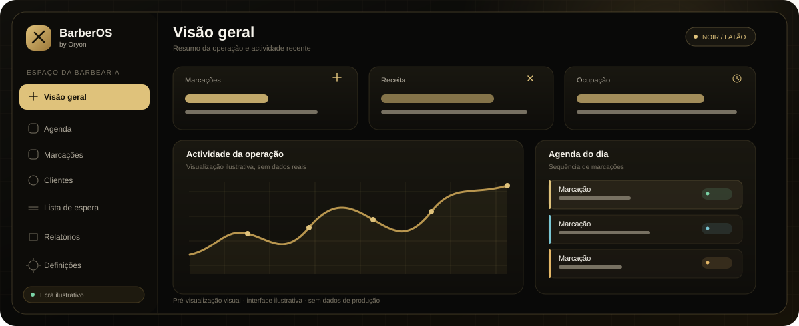
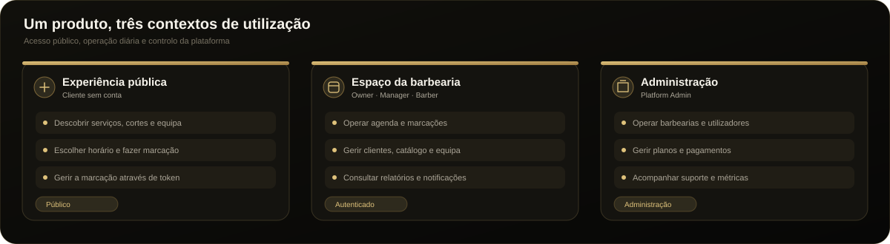
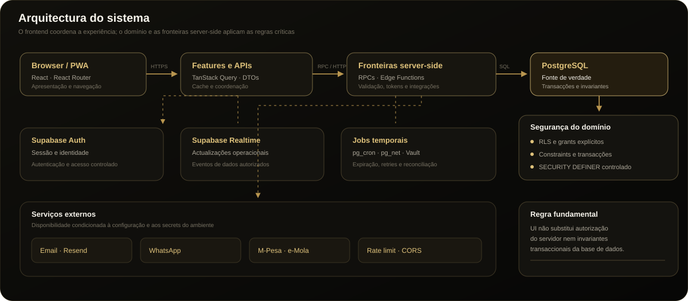
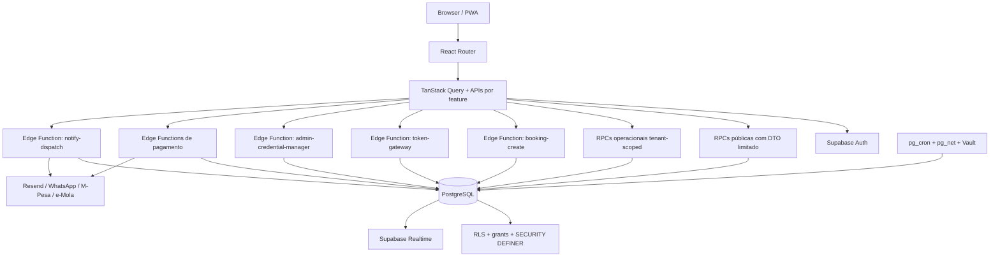
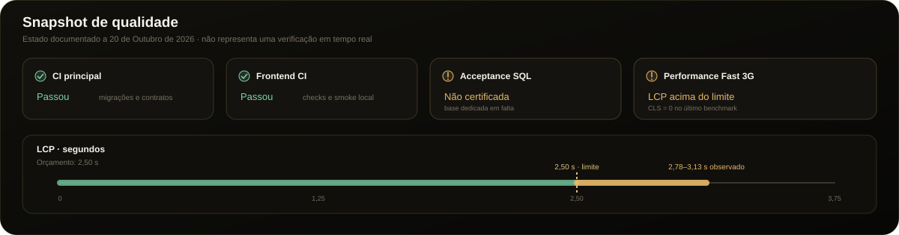

# BarberOS by Oryon

[](https://github.com/edmundokutuz333/BarberOS/actions/workflows/ci.yml)
[](https://github.com/edmundokutuz333/BarberOS/actions/workflows/frontend-ci.yml)
[](https://github.com/edmundokutuz333/BarberOS/actions/workflows/phase26-deployment-contract.yml)
[](https://github.com/edmundokutuz333/BarberOS/actions/workflows/phase25-performance.yml)

**BarberOS** é



 uma plataforma SaaS multi-tenant para a operação de barbearias. Combina uma experiência pública de descoberta e marcação sem conta com um espaço de gestão para proprietários, gestores e barbeiros, além de uma área administrativa para a operação da própria plataforma.

O produto foi concebido para o contexto moçambicano: interface em português, apresentação de preços em meticais, normalização de números móveis de Moçambique e regras de agenda que respeitam o fuso horário de cada barbearia. A arquitectura mantém o domínio crítico no PostgreSQL, em vez de duplicar as regras de negócio no browser.

> **Princípio de arquitectura:** o frontend apresenta e coordena a experiência; o PostgreSQL valida e decide o estado do domínio; as Edge Functions protegem as fronteiras HTTP e integram serviços externos. Uma interface não é considerada funcional só por renderizar, e um build verde não certifica, por si só, a produção.

---

## Índice

- [Visão do produto](#visão-do-produto)
- [Capacidades e estado de implementação](#capacidades-e-estado-de-implementação)
- [Mapa de rotas](#mapa-de-rotas)
- [Arquitectura do sistema](#arquitectura-do-sistema)
- [Stack tecnológica](#stack-tecnológica)
- [Estrutura do repositório](#estrutura-do-repositório)
- [Modelo de domínio](#modelo-de-domínio)
- [Fluxos críticos](#fluxos-críticos)
- [Autenticação, tenants e permissões](#autenticação-tenants-e-permissões)
- [API e Edge Functions](#api-e-edge-functions)
- [Base de dados e migrations](#base-de-dados-e-migrations)
- [Sistema visual, acessibilidade e PWA](#sistema-visual-acessibilidade-e-pwa)
- [Requisitos de desenvolvimento](#requisitos-de-desenvolvimento)
- [Configuração local](#configuração-local)
- [Variáveis de ambiente](#variáveis-de-ambiente)
- [Comandos de desenvolvimento](#comandos-de-desenvolvimento)
- [Testes e qualidade](#testes-e-qualidade)
- [Deployment e rollback](#deployment-e-rollback)
- [Segurança e privacidade](#segurança-e-privacidade)
- [Estado de certificação e limitações conhecidas](#estado-de-certificação-e-limitações-conhecidas)
- [Runbooks e documentação complementar](#runbooks-e-documentação-complementar)
- [Protocolo para alterações](#protocolo-para-alterações)
- [Resolução de problemas](#resolução-de-problemas)
- [Glossário](#glossário)

---

## Visão do produto

O BarberOS cobre três contextos de utilização distintos.





| Contexto | Utilizador | Objectivo |
|---|---|---|
| Experiência pública | Cliente sem conta | Descobrir uma barbearia, consultar serviços, cortes, equipa e horários, marcar, pagar um sinal quando aplicável e gerir a marcação através de um token |
| Espaço da barbearia | Owner, Manager ou Barber | Operar a agenda, gerir clientes e marcações, publicar o catálogo, definir horários, consultar métricas e acompanhar notificações, pagamentos, avaliações e lista de espera conforme as permissões |
| Administração da plataforma | Platform Admin | Operar barbearias, utilizadores, planos, pagamentos, suporte, métricas e actividade da plataforma |

### Princípios de produto

- **Marcação sem conta.** A jornada do cliente não depende de criar uma conta para reservar ou gerir uma marcação.
- **Fonte de verdade única.** A disponibilidade, a criação da marcação, a concorrência, o sinal e as transições críticas são decididos no PostgreSQL.
- **Isolamento por barbearia.** Os dados operacionais pertencem a um tenant identificado por `barbershop_id`. A interface não substitui as verificações de tenant feitas no servidor.
- **Sem escrita directa em tabelas críticas.** As operações de domínio passam por RPCs ou Edge Functions com contratos explícitos.
- **Falha fechada.** Quando faltam configurações de segurança, credenciais ou ambiente de teste, os respectivos gates devem falhar ou bloquear. A ausência de configuração não é uma aprovação.
- **UI com estados reais.** Loading, vazio, erro, conflito e sucesso devem corresponder a estados do sistema. Dados fictícios não devem ser usados para mascarar uma integração em falta.
- **Compatibilidade operacional.** A data e a hora devem ser interpretadas no fuso da barbearia; a base de dados e os jobs trabalham com timestamps consistentes.
- **Interfaces previsíveis.** O sistema visual, a navegação, as permissões, os testes e os contratos de domínio devem evoluir em conjunto.

## Capacidades e estado de implementação

A distinção entre ecrãs existentes, lógica de backend e serviços externos é intencional. Uma migration ou um tipo TypeScript não prova que uma funcionalidade já está disponível na navegação ou configurada no ambiente publicado.

### Experiências presentes na aplicação

| Área | Capacidades no código da aplicação |
|---|---|
| Entrada pública | Gateway, links curtos e resolução de barbearias por hostname |
| Perfil público | Identidade da barbearia, catálogo activo, cortes, equipa, horários, avaliações e contactos publicados |
| Booking wizard | Selecção de serviço, corte opcional, barbeiro, data, horário e dados do cliente |
| Gestão da marcação | Consulta por token, cancelamento e remarcação conforme as regras do domínio |
| Avaliação pública | Consulta e submissão de avaliação através do fluxo por token |
| Agenda | Visão diária e semanal, transições de estado e remarcação operacional |
| CRM | Pesquisa, listagem, métricas e detalhe de clientes |
| Lista de espera | Gestão operacional, ofertas de vagas e aceitação por token |
| Notificações | Consulta do estado da fila, métricas e retry manual controlado |
| Pagamentos | Configuração de providers, consulta de pagamentos, iniciação por token e verificação de estado |
| Catálogo e equipa | Serviços, cortes, barbeiros e horários |
| Relatórios | Resumo e agregações por dia, serviço, corte e barbeiro |
| Administração | Barbershops, detalhe, utilizadores, planos, pagamentos, suporte e métricas |
| Acesso | Registo, login, recuperação e alteração de palavra-passe, incluindo o fluxo de troca obrigatória |

### Fundações de backend

A cadeia de migrations inclui ainda fundações para convites de membros, portfólio, produtos, movimentos de stock, chaves API, webhooks, entregas de webhooks, subscrições push, consentimento de marketing, anonimização de clientes e soft delete. **Nem todas estas fundações correspondem a uma área de interface completa.** Antes de apresentar uma delas como funcionalidade pronta, confirmar o percurso completo: schema, grants/RLS, RPC ou Edge Function, frontend, testes e configuração operacional.

### Integrações condicionadas pelo ambiente

O código contém integrações para envio de email, WhatsApp, pagamentos M-Pesa/e-Mola, Cloudflare Turnstile, reconciliação de pagamentos, assets fotográficos e tarefas agendadas. A disponibilidade real depende de secrets, configuração do provider, migrations aplicadas, Edge Functions publicadas e testes de aceitação no ambiente certo. O repositório, isoladamente, não garante que cada integração esteja activa em produção.

---

## Mapa de rotas

O mapa abaixo reflecte as rotas registadas em `frontend/src/App.tsx`. Os acessos privados são envoltos por guards de autenticação e de administração.

### Rotas públicas e de autenticação

| Rota | Responsabilidade |
|---|---|
| `/` | Gateway público; num hostname de barbearia reconhecido, redirecciona para o perfil desse tenant |
| `/marcar` | Entrada de marcação associada ao hostname de uma barbearia |
| `/sobre` | Página comercial do produto |
| `/privacidade` | Informação de privacidade |
| `/termos` | Termos do serviço |
| `/b/:slug` | Link curto para o perfil público |
| `/barbearia/:slug` | Perfil público da barbearia |
| `/barbearia/:slug/marcar` | Booking wizard sem conta |
| `/marcacao/:token` | Consulta e gestão pública de uma marcação |
| `/marcacao/:token/avaliar` | Fluxo público de avaliação |
| `/vaga/:token` | Página de oferta de uma vaga da lista de espera |
| `/entrar` | Login |
| `/registar` | Registo |
| `/recuperar` | Recuperação de palavra-passe |
| `/alterar-palavra-passe` | Definição de uma palavra-passe pessoal após recuperação ou reset obrigatório |

### Espaço da barbearia

Todas as rotas abaixo estão sob `/app` e exigem autenticação.

| Rota | Responsabilidade |
|---|---|
| `/app` | Dashboard |
| `/app/onboarding` | Configuração inicial da barbearia |
| `/app/agenda` | Agenda operacional |
| `/app/marcacoes` | Consulta e operação de marcações |
| `/app/clientes` | CRM de clientes |
| `/app/clientes/:customerId` | Detalhe de cliente |
| `/app/lista-espera` | Lista de espera |
| `/app/notificacoes` | Estado e operação da fila de notificações |
| `/app/pagamentos` | Pagamentos e métricas |
| `/app/avaliacoes` | Avaliações e publicação |
| `/app/relatorios` | Relatórios de operação |
| `/app/servicos` | Catálogo de serviços |
| `/app/cortes` | Catálogo de cortes |
| `/app/barbeiros` | Equipa de barbeiros |
| `/app/horarios` | Horários e excepções |
| `/app/definicoes` | Redirecciona para as definições do perfil |
| `/app/definicoes/:tab` | Definições por separador |

A visibilidade dos menus e a autorização de acções dependem do papel do membro. A presença de uma rota não significa que todos os papéis a possam utilizar.

### Administração da plataforma

As rotas sob `/admin` exigem a condição de Platform Admin.

| Rota | Responsabilidade |
|---|---|
| `/admin` | Dashboard administrativo |
| `/admin/barbearias` | Listagem e operação de barbearias |
| `/admin/barbearias/:shopId` | Detalhe de barbearia |
| `/admin/utilizadores` | Gestão de utilizadores e reposição controlada de acesso |
| `/admin/planos` | Planos |
| `/admin/pagamentos` | Pagamentos da plataforma |
| `/admin/suporte` | Tickets de suporte |
| `/admin/metricas` | Métricas da plataforma |

As rotas wildcard de áreas internas podem apresentar o estado de funcionalidade ainda não disponível. Consultar sempre o código da rota e o respectivo ecrã antes de documentar ou anunciar uma nova capacidade.

---

## Arquitectura do sistema

### Visão lógica



<details>
<summary>Ver o diagrama Mermaid original</summary>



</details>

O diagrama representa fronteiras lógicas no código. Não serve como prova de que todas as Edge Functions e migrations estão publicadas no ambiente de produção.

### Camadas e responsabilidades

| Camada | Localização | Responsabilidade |
|---|---|---|
| Apresentação | `frontend/src/pages`, `frontend/src/components` | Páginas, formulários, estados visuais, acessibilidade e interacção |
| Shell e navegação | `frontend/src/components/layout` | Layout autenticado, shell administrativo, navegação desktop/mobile e guards |
| Features | `frontend/src/features` | Queries, mutations, DTOs e hooks organizados por domínio |
| Estado transversal | `frontend/src/lib` | Auth, Supabase client, contexto da barbearia, permissões, routing, tipos e utilitários |
| Contrato relacional | `supabase/migrations` | Schema, enums, constraints, índices, policies, triggers, funções e grants |
| Fronteiras HTTP | `supabase/functions` | Validação de pedidos, rate limit, tokens, providers, webhooks e operações server-side |
| Automação temporal | Migrations de scheduler e funções | Expiração de holds, processamento de notificações, rotação da lista de espera e reconciliação |
| Entrega web | Vercel e workflows GitHub Actions | Build, validação, publicação de artefactos e smoke da aplicação |

### Fluxo típico de leitura

1. Uma página invoca um hook da sua feature.
2. O hook usa TanStack Query para cache, loading, erros e invalidação.
3. A função da feature chama Supabase através de um RPC, Edge Function ou operação de leitura explicitamente permitida por RLS.
4. O PostgreSQL aplica os grants, policies, constraints e verificações de tenant.
5. A UI transforma a resposta num estado visível e accionável.

### Fluxo típico de escrita

As mutações de domínio não devem ser acrescentadas como um `insert`, `update` ou `delete` genérico no browser. A operação deve ter uma fronteira de servidor definida, validar actor e tenant, aplicar invariantes na base de dados e ser coberta por testes. Para operações críticas, a transacção do PostgreSQL é o ponto de atomicidade.

---

## Stack tecnológica

As versões exactas devem ser confirmadas nos manifests e no lockfile antes de uma actualização. Esta tabela descreve a stack existente no repositório.

| Componente | Tecnologia | Utilização |
|---|---|---|
| Runtime de desenvolvimento | Node.js 22 | Toolchain de frontend e CI |
| Package manager | Corepack + Yarn 1.22.22 | Instalação determinística com lockfile |
| Linguagem principal | TypeScript | Contratos e lógica de frontend |
| UI | React 19 | Componentes e páginas |
| Build/dev server | Vite 6 | Desenvolvimento, build e preview |
| Routing | React Router 7 | Routing SPA e lazy loading de páginas |
| Data fetching | TanStack Query 5 | Cache, mutations e invalidação |
| Backend platform | Supabase | Auth, PostgreSQL, Realtime, Storage e Edge Functions |
| Base de dados | PostgreSQL | Fonte de verdade transaccional |
| Forms | React Hook Form + Zod | Gestão e validação de formulários |
| UI primitives | Radix UI + componentes locais | Diálogos, menus, inputs, popovers e outros controlos |
| Styling | Tailwind CSS 3 + CSS tokens | Layout responsivo e sistema visual |
| Motion e gráficos | Framer Motion, Recharts | Movimento de interface e visualização de dados |
| Iconografia | Lucide React | Ícones |
| Internacionalização | i18next / react-i18next | Infraestrutura multi-idioma |
| PWA | vite-plugin-pwa / Workbox | Manifest, service worker e caching controlado |
| Browser testing | Playwright | Smoke E2E desktop e mobile |
| Acessibilidade | axe-core/Playwright e eslint-plugin-jsx-a11y | Auditoria e prevenção de regressões |
| Backend testing | pgTAP, SQL, Python/psycopg, Deno tests | Contratos de schema, comportamento e integração |

A aplicação não usa Create React App. O frontend actual usa Vite; a documentação antiga que ainda possa existir dentro de subpastas não deve ser usada como guia de execução.

---

## Estrutura do repositório

A estrutura abaixo destaca as fronteiras que devem ser respeitadas durante o desenvolvimento.

```text
BarberOS/
├── .github/
│   └── workflows/                # CI, deploy, performance, gates e rollback
├── .agents/                      # Skills e instruções específicas do projecto
├── docs/                         # Runbooks, arquitectura e contratos de domínio
├── frontend/
│   ├── public/                   # Assets estáticos, ícones e referências visuais
│   ├── src/
│   │   ├── components/
│   │   │   ├── background/       # Atmosfera e componentes visuais
│   │   │   ├── config/           # Editores de catálogo, equipa e horários
│   │   │   ├── layout/           # Shells, navegação e providers
│   │   │   ├── security/         # Componentes de integração anti-bot
│   │   │   └── ui/               # Primitives e componentes partilhados
│   │   ├── features/             # APIs e hooks por domínio
│   │   ├── lib/                  # Auth, client, permissões, tipos e utilitários
│   │   ├── pages/                # Rotas públicas, privadas e admin
│   │   ├── styles/               # Tokens visuais
│   │   └── themes/               # Temas scoped
│   ├── tests/
│   │   ├── unit/
│   │   ├── components/
│   │   └── e2e/
│   ├── package.json
│   ├── playwright.config.mjs
│   ├── vite.config.ts
│   └── yarn.lock
├── scripts/                      # Validação, acceptance, segurança e tooling
├── supabase/
│   ├── functions/
│   │   ├── _shared/              # Guards e adapters partilhados
│   │   └── ...                   # Edge Functions por fronteira de serviço
│   ├── migrations/               # Histórico canónico do schema
│   ├── tests/                    # Contratos e acceptance SQL
│   └── config.toml               # Project ref e configuração das funções
├── .env.example                  # Contrato de ambiente server/teste
├── frontend/.env.example         # Contrato de ambiente do browser
├── package.json                  # Pin do package manager e runtime
├── vercel.json                   # Regras de build, SPA e headers
└── README.md
```

### Regras para escolher onde colocar código

- Novo comportamento de uma feature existente deve ficar na feature correspondente, não num componente global sem necessidade.
- Os shells, os guards e a navegação são infra-estrutura da aplicação. Uma alteração neles pode afectar várias rotas.
- A lógica de disponibilidade, overlap, sinal e transições de marcação pertence ao domínio PostgreSQL.
- Uma integração externa deve ter adapter explícito e ficar dentro da Edge Function ou módulo server-side adequado.
- Alterações de schema entram numa nova migration timestamped.
- Testes unitários não substituem testes de integração SQL, e testes locais não substituem a aceitação contra staging.

---

## Modelo de domínio

O domínio principal liga a identidade da barbearia à operação da agenda e aos serviços públicos.

### Entidades principais

| Grupo | Entidades e propósito |
|---|---|
| Tenant e identidade | `barbershops`, `profiles`, `barbershop_members`, `plans` |
| Catálogo | `services`, `haircuts`, `barbers`, `barber_services` |
| Agenda | `working_hours`, `schedule_overrides`, `time_blocks`, `appointments` |
| Cliente | `customers`, consentimento e metadados de privacidade |
| Comunicação | `notifications`, estado de entrega, tentativas e automação |
| Pagamento | `payment_accounts`, `payments`, estados, referências de provider e reconciliação |
| Reputação | `reviews`, publicação e acesso por token |
| Retenção de vagas | `waitlist_entries`, ofertas e tokens públicos |
| Governança | `audit_logs`, `support_tickets`, eventos de acesso e funções administrativas |

Migrations mais recentes incluem fundações adicionais, como `member_invites`, `portfolio_items`, `products`, `stock_movements`, `api_keys`, `webhooks`, `webhook_deliveries` e `push_subscriptions`. Antes de utilizar estas entidades numa feature, verificar se os tipos gerados, permissões e interfaces já cobrem o caso concreto.

### Valores e estados

- Os valores monetários persistidos em colunas como `price_cents`, `deposit_cents` e `amount_cents` são valores inteiros em unidades menores. A formatação para MT é feita na apresentação.
- Os estados de negócio são enums PostgreSQL, por exemplo `appointment_status`, `deposit_state`, `payment_state`, `notif_status`, `waitlist_status` e `app_role`.
- Os timestamps devem conservar a semântica de instante. A conversão para hora local é feita com o fuso configurado na barbearia.
- O número de telefone é normalizado no boundary de domínio. O formato apresentado ao utilizador não deve tornar-se uma segunda regra de validação concorrente com o backend.
- Os campos de tenant devem ser validados em conjunto. Uma referência de serviço, corte ou barbeiro de outra barbearia é inválida mesmo que o UUID exista.

---

## Fluxos críticos

### 1. Descoberta e booking público

O cliente chega ao perfil público, consulta apenas o catálogo publicado e percorre seis passos no wizard.

```text
Perfil público
    ↓
Serviço
    ↓
Corte, quando aplicável
    ↓
Barbeiro ou qualquer barbeiro
    ↓
Data
    ↓
Horário calculado pelo PostgreSQL
    ↓
Dados do cliente
    ↓
Edge Function de booking
    ↓
Transacção PostgreSQL
    ↓
Resultado seguro + token de gestão
```

Regras importantes:

- O catálogo público é obtido através do RPC `get_public_barbershop`.
- Os dias e slots vêm do Availability Engine.
- O browser não decide sozinho se um horário está disponível.
- O cliente não precisa de conta para concluir o pedido.
- Nome, telefone e email não devem ser colocados nos query parameters da URL.
- Uma opção apresentada na UI não é uma reserva até o backend confirmar a transacção.
- Um conflito deve invalidar a selecção do horário e permitir ao cliente escolher novamente, sem repetir automaticamente a reserva noutro slot.

### 2. Availability Engine

A disponibilidade é calculada no PostgreSQL pelas funções de disponibilidade, incluindo `get_available_days`, `get_available_slots` e a leitura semanal correspondente.

O motor considera:

1. Estado da barbearia.
2. Serviço activo e pertencente ao tenant.
3. Barbeiro activo e associado ao serviço, quando seleccionado.
4. Fuso horário da barbearia e duração real do serviço.
5. Horário semanal base e overrides por barbeiro.
6. Excepções de calendário da loja ou do barbeiro.
7. Lead time mínimo e janela máxima de reserva.
8. Marcações que ocupam o período.
9. Bloqueios globais da loja e bloqueios específicos do barbeiro.
10. Restrições de overlap e holds pendentes ainda válidos.

A grelha de início dos slots não é a duração do serviço. Um serviço que dure 40 minutos continua a ocupar os 40 minutos completos, mesmo que a grelha tenha intervalos de 15 minutos.

### 3. Booking Engine e concorrência

O caminho de booking usa locks transaccionais por barbeiro, revalida disponibilidade e mantém a constraint de overlap como última barreira.

```text
Pedido de booking
    ↓
Validação de tenant, serviço, corte e barbeiro
    ↓
Lock transaccional por barbeiro
    ↓
Revalidação da disponibilidade
    ↓
Upsert do cliente no âmbito da barbearia
    ↓
Cálculo e validação do sinal
    ↓
Inserção atómica da marcação
    ↓
Exclusion constraint contra overlap
    ↓
Fila de notificações + audit log
```

O contrato de conflito inclui códigos como `SLOT_TAKEN` e `SLOT_UNAVAILABLE`. A resposta HTTP do gateway deve traduzir o conflito para o contrato esperado pelo cliente. A criação online e a marcação manual não devem evoluir para motores de reserva independentes.

O repositório inclui uma camada de gateway de booking que usa chave de idempotência, limites de pedidos e integração anti-bot. A presença deste código não prova que a mesma versão esteja aplicada no Supabase live; a certificação exige schema e Edge Function alinhados.

### 4. Sinal e pagamentos

Quando a configuração da barbearia e do serviço exige sinal:

- A marcação começa em estado pendente.
- O pagamento fica associado à marcação e à referência de provider.
- O hold tem um prazo definido.
- A confirmação exige estado de pagamento compatível com a regra do domínio.
- A expiração do hold não depende apenas do browser.
- A reconciliação tem de considerar callbacks, retries, estados pendentes e respostas tardias do provider.

Os fluxos de pagamento no código suportam M-Pesa e e-Mola através de adapters partilhados. As operações de iniciar, verificar, reconciliar e receber webhooks têm de funcionar com credenciais server-side. Não armazenar credenciais do provider no browser nem aceitar a confirmação de pagamento enviada pelo cliente como prova.

Antes de anunciar pagamento real como activo, validar as contas e credenciais no provider, assinatura/autenticidade de callbacks, reconciliação, idempotência e comportamento perante timeout.

### 5. Gestão da marcação por token

O token de gestão é a identidade pública da marcação. O DTO público deve expor apenas os dados necessários para o cliente consultar, cancelar ou remarcar, sem revelar identificadores internos que não sejam necessários ao fluxo.

A operação de remarcação deve voltar a consultar a disponibilidade real, respeitar a política da barbearia e rejeitar slots entretanto ocupados. O cancelamento tem de libertar a ocupação lógica, impedir notificações futuras incompatíveis e criar a respectiva auditoria.

### 6. Agenda operacional e Realtime

A agenda lê read models tenant-scoped através de RPCs. O backend valida o actor, o tenant e a transição.

Transições de estado incluem, conforme o domínio, pendente, confirmada, em atendimento, concluída, no-show e cancelada. A confirmação de uma reserva com sinal tem de respeitar o estado do pagamento.

A remarcação operacional usa o Availability Engine e pode precisar de locks determinísticos para o barbeiro de origem e destino. O Realtime recebe eventos da tabela de marcações e invalida o read model para sincronizar a interface. O Realtime melhora a actualização visual, mas não substitui as transacções nem as regras de concorrência.

### 7. Lista de espera

O fluxo previsto é:

```text
Cliente sem vaga
    ↓
Entrada waiting
    ↓
Libertação de horário
    ↓
Selecção de uma entrada elegível
    ↓
Oferta com validade limitada
    ↓
Cliente aceita pelo token público
    ↓
Booking Engine cria a reserva
    ↓
Entrada converted
```

A oferta, a expiração e a rotação da fila devem ser atómicas e auditáveis. A expiração de uma oferta permite que o próximo cliente elegível seja considerado sem depender de uma acção manual na interface.

### 8. Notificações

Os eventos de domínio entram numa fila persistente. O dispatcher reclama um lote, entrega através de providers configurados e actualiza o estado. Falhas temporárias devem ser distinguidas de falhas definitivas, com backoff e retry controlado. Os workers não devem processar o mesmo lote simultaneamente.

Os canais no domínio incluem email e WhatsApp. A ordem de preferência e a elegibilidade de cada canal dependem da configuração e dos dados disponíveis. Remarcações, cancelamentos, conclusão e expiração têm de actualizar a fila para evitar lembretes contraditórios.

### 9. CRM, avaliações, relatórios e administração

- **CRM:** consultas paginadas e tenant-scoped, métricas de visitas/no-show e histórico do cliente.
- **Avaliações:** consulta e submissão através de token, com regras para estado elegível da marcação e publicação controlada.
- **Relatórios:** agregações calculadas pela base de dados, não por downloads completos de tabelas para o browser.
- **Administração:** operações privilegiadas através de funções administrativas, com verificação de actor e auditoria.
- **Credenciais:** Supabase Auth gere as palavras-passe. A aplicação mantém apenas os dados de perfil e flags operacionais necessários. A reposição temporária de acesso deve ser autenticada, limitada, devolvida uma única vez e nunca persistida em logs, Git ou tabelas da aplicação.

---

## Autenticação, tenants e permissões

### Papéis

O enum de papel da barbearia inclui os seguintes actores:

| Papel | Âmbito normal |
|---|---|
| `owner` | Administração da própria barbearia, equipa, catálogo, horários, pagamentos e definições permitidas |
| `manager` | Operação e configuração permitida da barbearia, sem privilégios exclusivos do Owner |
| `barber` | Operação no âmbito do seu perfil e das regras específicas da agenda |
| Platform Admin | Administração global da plataforma, com fronteiras e auditoria próprias |

O código do frontend centraliza parte do mapeamento de rotas e navegação em `frontend/src/lib/permissions.ts`. Isto serve para a experiência do utilizador, não como controlo de segurança suficiente. O backend deve voltar a validar o papel e o tenant em qualquer operação privilegiada.

### Fronteiras de autorização

- Auth identifica o utilizador.
- O perfil e os membros determinam o papel e a associação à barbearia.
- RLS e funções PostgreSQL limitam os dados visíveis.
- RPCs privilegiadas verificam o actor, tenant e argumentos.
- Edge Functions que usam service role validam explicitamente a autorização de cada pedido. Ter uma chave server-side não autoriza um pedido do browser.
- Tokens públicos são credenciais portadoras: não devem entrar em logs de analytics, query strings auxiliares ou mensagens de erro.
- A navegação escondida não substitui a autorização no servidor.

---

## API e Edge Functions

As Edge Functions encontram-se em `supabase/functions`. Os nomes e as implementações no repositório são a referência de código; confirmar o deployment e o modo de autenticação de cada função antes de depender dela em produção.

| Função | Responsabilidade |
|---|---|
| `booking-create` | Fronteira HTTP para booking público, validação do payload, protecção anti-abuso e chamada do RPC idempotente |
| `waitlist-join` | Fronteira HTTP para entrada pública na lista de espera, com validação e limites por IP, telefone e barbearia |
| `token-gateway` | Operações públicas de gestão da marcação, avaliações e lista de espera através de acções permitidas |
| `admin-credential-manager` | Gestão privilegiada de reset e troca obrigatória de palavra-passe, com actor autenticado e auditoria |
| `payments-configure` | Configuração de provider de pagamento pela área autorizada |
| `payments-initiate` | Criação/iniciação de pedido de pagamento e registo do estado no domínio |
| `payments-status` | Consulta e reconciliação do estado do pagamento por token |
| `payments-webhook` | Recepção e tratamento de callbacks de provider |
| `payments-reconcile` | Reconciliação de pagamentos pendentes através do scheduler autorizado |
| `notify-dispatch` | Reclamação de notificações, entrega pelos adapters e registo de retry/resultado |
| `resend-webhook` | Tratamento de eventos de entrega do provider de email |
| `barber-assets` | Servir referências fotográficas allowlisted sem aceitar URLs arbitrários como proxy aberto |
| `health` | Health check técnico com verificação de acesso à base de dados |

### Código partilhado

- `supabase/functions/_shared/guard.ts`: cliente administrativo, CORS, rate limit, hash e validação Turnstile.
- `supabase/functions/_shared/payment-providers.ts`: adapters partilhados de provider de pagamento.
- Cada função define o seu método HTTP, validação do pedido, modo de autenticação, formato de erro e headers de cache. Não copiar uma configuração CORS ou de autenticação de outra função sem avaliar a fronteira actual.

### Contratos internos

A definição corrente de uma RPC deve ser consultada no conjunto ordenado de migrations e, antes de um release, validada no schema do ambiente-alvo. `docs/RPC_REFERENCE.md` documenta os contratos principais, mas não substitui uma auditoria dos grants reais.

---

## Base de dados e migrations

### PostgreSQL é a fonte de verdade

A pasta `supabase/migrations/` contém o histórico versionado do schema, incluindo tabelas, enums, índices, constraints, triggers, policies, funções e permissões. A aplicação não deve criar schema de domínio durante o runtime.

A cadeia actual contém **mais de 100 migrations timestamped**. O seu histórico inclui, em linhas gerais:

| Grupo | Responsabilidade |
|---|---|
| Schema inicial e RLS | Estrutura core, roles, policies e boundaries de acesso |
| Integridade do domínio | Constraints, tenant integrity, configuração atómica de barbeiros e horários |
| Availability Engine | Slots, dias, timezone, overrides, bloqueios e protecção de leitura |
| Booking Engine | Reserva, concorrência, sinal, normalização de telefone, notificações e auditoria |
| Gestão por token e perfil público | Consulta/cancelamento/remarcação pública, perfil de barbearia e contratos públicos |
| Agenda e marcações manuais | Read models, transições de estado, locks e realtime |
| CRM e lista de espera | Histórico de clientes, métricas, ofertas, expiração e conversão de vagas |
| Notificações e scheduler | Fila, retries, recuperação de jobs presos, cron e entrega |
| Pagamentos | Contas, iniciação, webhooks, reconciliação, holds e estados tardios |
| Avaliações, relatórios e admin | Publicação de reviews, agregações, suporte e operações administrativas |
| Performance e hardening | Índices tenant-scoped, fronteiras de tokens, booking gateway e regras de acesso |
| Fundamentos de plataforma | Privacidade, gestão de acessos, catálogo visual e outros domínios adicionados posteriormente |

### Regras de migration

1. **Nunca renomear ou reordenar uma migration já aplicada.**
2. Criar uma nova migration timestamped para cada alteração de schema.
3. Testar a cadeia completa a partir de uma base local vazia.
4. Examinar o SQL, grants, RLS, índices e impacto nos dados antes de um release.
5. Comparar o histórico local com o histórico do projecto Supabase.
6. Aplicar mudanças através do workflow controlado, depois de staging aprovado.
7. Regenerar os tipos TypeScript a partir do schema pretendido e rever o diff.
8. Verificar o resultado na base de dados alvo, e não apenas a presença do ficheiro no Git.

### Operações proibidas em produção

- Não executar `supabase db reset --linked`.
- Não correr scripts mutáveis de acceptance contra a base de produção.
- Não fazer replay cego do histórico completo para esconder divergências de versão.
- Não alterar dados de negócio através de SQL ad-hoc quando a alteração deve ser uma operação de domínio.
- Não usar `migration repair` como forma de silenciar diferenças sem reconciliação individual.
- Não lançar migrations de hardening sem confirmar que as Edge Functions compatíveis serão publicadas na ordem correcta.

### Tipos gerados

`frontend/src/lib/database.types.ts` tipa o cliente Supabase e as chamadas às funções expostas pelo contrato gerado. Sempre que uma migration acrescentar entidades ou RPCs, confirmar que o ficheiro acompanha o schema real usado pela aplicação. Uma tabela numa migration não aparece automaticamente nos tipos, e um tipo existente não prova que a função correspondente esteja publicada no ambiente live.

---

## Sistema visual, acessibilidade e PWA

### Direcção visual

A implementação actual segue a direcção **noir & brass**: canvas quase preto, superfícies carvão, texto neutro quente, contornos subtis e acentos em latão. A landing comercial tem uma presença visual mais expressiva; o perfil público usa uma apresentação fotográfica; formulários, gestão operacional e páginas de token utilizam uma atmosfera mais contida.

Fontes de referência:

- Tokens: `frontend/src/styles/tokens.css`
- Estilos comuns e layout: `frontend/src/index.css`
- Atmosfera por rota: `frontend/src/components/background/BarberAtmosphere.tsx`
- Direcção de UI/UX: `docs/FRONTEND-DESIGN-SYSTEM.md`

Os temas da barbearia devem ser aplicados de forma scoped e não devem alterar acidentalmente o canvas global da plataforma.

### Acessibilidade e experiência

A suite e os componentes partilhados cobrem, entre outros:

- foco visível e navegação por teclado;
- skip link e anúncio de navegação;
- estados de erro, loading e vazio;
- labels, semântica e contraste;
- redução de movimento;
- layouts responsivos para desktop e mobile;
- auditorias de acessibilidade com axe-core nos percursos smoke.

O objectivo de uma auditoria passar é controlar regressões, não declarar automaticamente conformidade legal integral de todos os percursos.

### PWA e cache

O Vite PWA plugin configura o manifest e o service worker. O caching em runtime é limitado a media público de Storage, com estratégia de revalidação e limite de entradas/idade. O caching de assets buildados é separado, com nomes versionados e headers imutáveis no Vercel.

Dados privados, tokens, informação de clientes e resultados de operações não devem ser adicionados ao cache público por conveniência.

### Performance

O workflow de Phase 25 verifica os budgets do grafo de assets inicial e corre benchmark de browser sob throttling de rede. Os budgets documentados são:

| Métrica | Limite |
|---|---:|
| JavaScript inicial, gzip | 300 KB |
| JavaScript inicial, Brotli | 250 KB |
| CSS inicial, gzip | 80 KB |
| Total inicial, gzip | 360 KB |
| LCP em Fast 3G | 2500 ms |
| CLS | 0,10 |
| DOMContentLoaded | 1800 ms |
| Roundtrip observado do RPC público | 1200 ms |
| Interacção de laboratório (INP) | 200 ms |

Não aumentar um limite apenas para tornar o CI verde. Medir o elemento que provoca a regressão, corrigir a causa e correr novamente desktop e mobile.

---

## Requisitos de desenvolvimento

| Requisito | Versão ou regra |
|---|---|
| Node.js | 22.x, definido por `.nvmrc` |
| Package manager | Corepack + Yarn 1.22.22 |
| Supabase CLI | Necessário para migrations e testes locais de PostgreSQL |
| Docker | Necessário para executar o stack Supabase local |
| Python | 3.12 no workflow de acceptance SQL |
| psycopg | Utilizado pelos scripts Python de integração com PostgreSQL |
| Deno | Utilizado nos testes de contrato de Edge Functions |
| Chromium | Instalado pelo Playwright para os testes de browser |

Para comportamento de produção, usar o ambiente de staging isolado. A aplicação pode iniciar localmente com uma configuração de browser, mas leitura de dados, autenticação, booking, payments e entrega de notificações exigem um backend configurado e os respectivos secrets.

---

## Configuração local

### 1. Obter o código e seleccionar o runtime

```sh
git clone https://github.com/edmundokutuz333/BarberOS.git
cd BarberOS
nvm install
nvm use
corepack enable
```

O ficheiro `.nvmrc` define Node 22. O `packageManager` fixa Yarn através do Corepack; não substituir por uma versão arbitrária de Yarn/npm durante o trabalho normal.

### 2. Configurar o frontend

```sh
cd frontend
corepack yarn install --frozen-lockfile
cp .env.example .env.local
```

Preencher `.env.local` com a URL e a publishable key do projecto Supabase de desenvolvimento. O ficheiro `frontend/.env.example` é o contrato de variáveis do browser.

```dotenv
VITE_SUPABASE_URL=https://your-project.supabase.co
VITE_SUPABASE_PUBLISHABLE_KEY=sb_publishable_your-key
VITE_BARBEROS_ROOT_DOMAIN=
```

O root domain é opcional em localhost e preview. Mantê-lo vazio permite usar URLs no formato `/barbearia/:slug`.

### 3. Arrancar a aplicação

Na pasta `frontend`:

```sh
corepack yarn start
```

Abrir [http://localhost:3000](http://localhost:3000). Para executar contra o build de produção local:

```sh
corepack yarn build
corepack yarn preview --host 127.0.0.1 --port 4173 --strictPort
```

### 4. Supabase local

Os testes de migration e pgTAP usam um ambiente Supabase isolado. Quando o Docker e o Supabase CLI estiverem configurados:

```sh
supabase start
supabase db reset
```

**Este reset destina-se apenas ao ambiente local descartável.** Antes de ligar qualquer comando a um projecto remoto, verificar o target activo e ler o runbook de release. Nunca assumir que o contexto do terminal é local.

---

## Variáveis de ambiente

Os exemplos estão em `.env.example` e `frontend/.env.example`. São templates, não uma lista de valores de produção a copiar cegamente.

### Browser / Vercel

| Variável | Obrigatória | Finalidade |
|---|---|---|
| `VITE_SUPABASE_URL` | Sim | URL do projecto Supabase utilizado pelo browser |
| `VITE_SUPABASE_PUBLISHABLE_KEY` | Sim | Publishable key destinada ao cliente público |
| `VITE_BARBEROS_ROOT_DOMAIN` | Opcional | Domínio base para URLs por subdomínio de barbearia |
| `VITE_TURNSTILE_SITE_KEY` | Conforme configuração de booking | Chave pública do widget Turnstile |
| `VITE_BOOKING_TURNSTILE_REQUIRED` | Gate de release | Define o requisito de Turnstile na jornada pública quando configurado no deployment |

Uma variável com prefixo `VITE_` fica disponível ao browser no build. **Nunca colocar service role, passwords, API keys privadas, tokens de provider ou segredos de webhook nesse namespace.** A publishable key não substitui RLS nem a autorização do servidor.

### Runtime server-side

Os nomes concretos dependem da função e do provider. A configuração de referência contempla:

| Variável | Finalidade |
|---|---|
| `SUPABASE_URL` | URL do projecto para os clientes server-side |
| `SUPABASE_SERVICE_ROLE_KEY` ou secret equivalente configurado para o runtime | Operações privilegiadas executadas por Edge Functions |
| `ALLOWED_ORIGINS` | Allowlist de origins admitidas pelos endpoints que a utilizam |
| `RATE_LIMIT_SALT` | Salt privado para os buckets/identificadores do rate limit |
| `TURNSTILE_SECRET_KEY` | Verificação server-side do token anti-bot |
| `RESEND_API_KEY` | Envio de email via Resend |
| `RESEND_WEBHOOK_SECRET` | Verificação do webhook do provider de email |
| `NOTIFICATION_EMAIL_FROM` | Remetente de email validado no domínio |
| `WHATSAPP_ACCESS_TOKEN` | Acesso server-side ao provider WhatsApp |
| `WHATSAPP_PHONE_NUMBER_ID` | Identificador do número configurado no provider |
| `WHATSAPP_GRAPH_VERSION` | Versão da API utilizada pelo adapter |
| `WHATSAPP_TEMPLATES_JSON` | Metadados dos templates autorizados de WhatsApp |
| `BARBEROS_PUBLIC_URL` | URL pública usada em links de notificações e smoke tests |

O runtime pode aceitar nomes de secret equivalentes conforme o adapter; verificar a função específica antes de alterar a configuração. Os secrets ficam no ambiente server-side Supabase/Vercel/GitHub, não no repositório.

### Testes e CI

| Variável | Uso |
|---|---|
| `BARBEROS_TEST_DATABASE_URL` | URL de uma base dedicada para acceptance tests |
| `BARBEROS_TEST_ALLOW_MUTATION=1` | Confirmação explícita exigida pelo runner de testes de domínio mutáveis |
| `BARBEROS_TEST_EMAIL` / `BARBEROS_TEST_PASSWORD` | Conta dedicada para E2E autenticado, quando a suite completa é activada |
| `BARBEROS_E2E_BASE_URL` | URL da aplicação alvo em Playwright |
| `BARBEROS_E2E_FULL` e `BARBEROS_E2E_FULL_RESET_URL` | Activação e reset explícito do ambiente de full lifecycle E2E |
| `BARBEROS_E2E_CONCURRENCY_*` | Configuração da suite HTTP de concorrência numa barbearia e slot de teste dedicados |

Não utilizar uma conta de cliente real ou uma base de produção para preencher variáveis de teste.

---

## Comandos de desenvolvimento

Executar os comandos de frontend dentro de `frontend/`, salvo indicação em contrário.

| Comando | Resultado |
|---|---|
| `corepack yarn start` | Vite em modo de desenvolvimento |
| `corepack yarn build` | Build de produção |
| `corepack yarn preview --host 127.0.0.1 --port 4173 --strictPort` | Serve o build local para smoke tests |
| `corepack yarn lint` | ESLint, sem warnings permitidos |
| `corepack yarn typecheck` | TypeScript sem emissão |
| `corepack yarn test` | Unit, componentes e contratos frontend das fases 23, 24 e 25 |
| `corepack yarn test:unit:phase23` | Testes unitários de domínio |
| `corepack yarn test:components:phase23` | Testes de componentes reais |
| `corepack yarn test:contracts:phase23` | Contratos de páginas |
| `corepack yarn test:unit:phase24` | Testes unitários de concorrência |
| `corepack yarn test:contracts:phase24` | Contratos frontend de concorrência |
| `corepack yarn test:contracts:phase25` | Contratos frontend de performance |
| `corepack yarn test:e2e:smoke` | Smoke E2E desktop/mobile no build local |
| `corepack yarn test:e2e` | Suite Playwright definida no projecto |
| `corepack yarn a11y:phase21` | Auditoria de acessibilidade |
| `corepack yarn perf:budget` | Budget de assets do primeiro carregamento |
| `corepack yarn deploy:contract` | Contrato de configuração Vercel |
| `corepack yarn supabase:contract` | Validação estática da cadeia de release Supabase |

Outros scripts de raiz incluem scanners de secrets, validação do release, smoke de produção e suites Python de acceptance. Consultar cada script antes de o executar, principalmente se abrir uma ligação PostgreSQL ou tiver permissão para mutar dados.

---

## Testes e qualidade

O projecto usa camadas de teste com responsabilidades diferentes.

| Camada | Ferramentas / ficheiros | O que valida |
|---|---|---|
| Static checks | ESLint, TypeScript, scripts de contrato | Sintaxe, tipos e invariantes estruturais |
| Unit | `frontend/tests/unit` | Domínio, normalização de Meticais/telefone, erros, calendário, links e permissões |
| Component | `frontend/tests/components` | Semântica renderizada de componentes e contratos de UI |
| Browser smoke | Playwright + Chromium desktop/mobile | Rotas, runtime browser, acessibilidade grave/crítica e jornada pública segura |
| Full lifecycle E2E | `phase23-full-lifecycle.spec.mjs` | Registo, onboarding, configuração e jornada autenticada, se existir um ambiente E2E dedicado |
| Edge Function | Deno tests e contratos locais | Contratos HTTP e classificação de erros de fronteiras específicas |
| SQL / pgTAP | `supabase/tests/*.sql` | Schema, grants, RLS, constraints, funções, segurança e contratos de domínio |
| Acceptance PostgreSQL | Scripts Python + psycopg | Fluxos que precisam de dados de teste e transacções reais |
| Performance | Playwright CDP e asset budget | LCP, CLS, DCL, roundtrip de RPC, interacção e tamanho dos assets |
| Release | GitHub Actions + scripts de validação | Configuração, presença de gates e deployment safety |

### Testes de base de dados

A cadeia de CI principal aplica as migrations numa base local vazia e executa os contratos pgTAP compatíveis. As suites comportamentais antigas podem exigir lojas, utilizadores, marcações ou pagamentos de fixture. Essas suites precisam de uma base dedicada, com dados de teste e permissões próprias.

O runner de acceptance exige variáveis explícitas e recusa continuar se a base dedicada ou o opt-in mutável não estiverem configurados. Essa falha é deliberada e significa **não certificado**, não sucesso implícito.

### Testes E2E

O Playwright usa Chromium desktop e um projecto mobile, locale `pt-PT` e timezone `Africa/Maputo`. Os testes de smoke podem ignorar os percursos que dependem de um ambiente real dedicado, conforme a configuração. O full lifecycle autenticado não deve utilizar contas de produção.

### Estado recente dos gates




Snapshot de revisão de **20 de Outubro de 2026**, antes de alterações documentais:

| Gate | Resultado observado | Interpretação |
|---|---|---|
| Verificação principal | Passou | Migrações numa base vazia, contratos pgTAP e frontend do workflow principal passaram |
| Frontend CI | Passou | Typecheck, build, lint, unit/components, smoke e budgets locais passaram |
| Contrato de deployment | Passou | Configuração e verificações estáticas de release passaram |
| Acceptance SQL dedicada | Não certificada | `BARBEROS_TEST_DATABASE_URL` não estava configurada; o runner falhou fechado |
| Contrato SQL de performance | Não certificado | Exige a mesma base dedicada |
| Benchmark público Fast 3G | Falhou | LCP observado entre cerca de 2,78 e 3,13 segundos, acima do limite de 2,5 segundos; o CLS do último benchmark foi zero |
| Full lifecycle autenticado | Condicionado | Requer credenciais e ambiente E2E dedicado |

Este quadro é uma fotografia datada, não um badge permanente. Consultar as execuções recentes no GitHub Actions antes de anunciar uma fase como concluída. Uma alteração de código pode ter iniciado uma nova execução depois deste snapshot.

---

## Deployment e rollback

### Topologia de produção

- **GitHub `main`:** histórico de código, migrations e workflows.
- **Vercel:** build estático React/Vite e entrega da SPA.
- **Supabase:** Auth, PostgreSQL, RLS, funções, Storage, Realtime e jobs.
- **Providers externos:** email, WhatsApp e pagamentos quando configurados.

A publicação do frontend e a publicação do schema/Edge Functions são operações diferentes. A versão do browser, das migrations e das Edge Functions tem de ser compatível.

### Vercel

O `vercel.json` configura:

- instalação determinística com Corepack e lockfile frozen;
- build de Vite e output `dist`;
- rewrite SPA para `index.html`, incluindo deep links;
- cache imutável para assets versionados;
- headers como CSP, HSTS, X-Frame-Options, Referrer-Policy e Permissions-Policy.

O workflow de Vercel corre preflight, valida configuração, constrói artefactos, publica o deployment e tenta executar smoke de produção. O smoke depende de uma URL pública configurada. Um deployment em estado READY não prova que todos os fluxos de domínio ou todos os providers externos estejam operacionais.

### Supabase

O workflow de produção é manual e protegido. A sequência geral é:

1. Verificar a autorização explícita e a aceitação de staging.
2. Confirmar secrets obrigatórios sem imprimir os respectivos valores.
3. Executar os contratos de release e a análise de secrets.
4. Inspeccionar `supabase db push --dry-run`.
5. Aplicar as migrations aprovadas, respeitando a sequência de hardening.
6. Publicar as Edge Functions compatíveis.
7. Executar health check e smoke de release.
8. Registar o resultado da operação.

O fluxo tem um gate de confirmação manual, com a frase exacta `APPLY-SUPABASE-PRODUCTION`, e flags de ambiente que só devem ser activadas após a reconciliação histórica, configuração de segurança e aceitação de staging. Não marcar esses flags como verdadeiros apenas para desbloquear um deployment.

### Credenciais típicas do workflow de release

Conforme o workflow usado, o ambiente pode exigir:

- `SUPABASE_ACCESS_TOKEN`
- `SUPABASE_DB_PASSWORD`
- `VERCEL_TOKEN`
- `VERCEL_ORG_ID`
- `VERCEL_PROJECT_ID`
- `BARBEROS_PUBLIC_URL`

Os controlos de release Supabase incluem ainda variáveis como `BARBEROS_PRODUCTION_MIGRATION_HISTORY_RECONCILED`, `BARBEROS_TURNSTILE_CONFIGURED`, `BARBEROS_RESEND_CONFIGURED` e `BARBEROS_STAGING_VERIFIED`. Consultar o workflow actual antes de preparar o ambiente.

### Rollback

O workflow `.github/workflows/rollback-vercel.yml` oferece uma operação manual de rollback de deployment Vercel. O rollback do frontend não reverte automaticamente migrations PostgreSQL nem uma alteração incompatível de Edge Functions.

Para um incidente que envolva schema ou dados:

1. interromper alterações mutáveis não essenciais;
2. identificar exactamente que versões foram publicadas;
3. confirmar backup, integridade e impacto;
4. decidir se a recuperação é de código, function, schema ou dados;
5. executar apenas o procedimento aprovado para esse tipo de alteração;
6. verificar health, autenticação, booking, pagamentos e notificações depois da recuperação.

Nunca assumir que reverter o bundle do browser é suficiente para restaurar o domínio.

---

## Segurança e privacidade

### Modelo de segurança

- **RLS:** isola os dados dos tenants e limita a leitura/escrita de acordo com o papel.
- **Grants explícitos:** funções e tabelas não devem herdar permissões públicas por omissão.
- **SECURITY DEFINER:** usado quando uma operação de domínio precisa de privilégio controlado; deve ter search path fixo e validar cada entrada.
- **Writes controladas:** appointments, payments, notifications, reviews, waitlist e audit logs não devem receber DML directo do browser fora dos grants explícitos.
- **Idempotência e concorrência:** o booking tem de tolerar pedidos repetidos sem duplicar a reserva; a disponibilidade é revalidada dentro da operação transaccional.
- **Tokens públicos:** DTOs limitados, sem IDs internos desnecessários, cache desactivada para respostas sensíveis e validade/política verificadas no servidor.
- **Rate limiting e anti-bot:** são componentes da fronteira de booking e de outras operações sensíveis. A configuração live tem de ser verificada, não presumida.
- **Secrets server-side:** chaves privadas nunca passam por Vite, assets, query strings ou logs.
- **Auditoria:** operações sensíveis e mudanças de estado devem registar actor, tenant, entidade e resultado sem guardar segredos.
- **Headers e origem:** CSP, HSTS, X-Frame-Options, Referrer-Policy, allowlists e configuração CORS devem manter-se coerentes com a superfície real da aplicação.
- **Privacidade:** consentimento de marketing, anonimização e soft delete exigem contratos próprios e devem preservar a auditabilidade das operações permitidas.

### Política de credenciais

As palavras-passe definitivas pertencem ao Supabase Auth. O BarberOS não deve guardar passwords numa tabela própria, ficheiro, README, commit ou histórico de auditoria. O fluxo administrativo de reset usa uma credencial temporária devolvida uma única vez, exige troca de palavra-passe e regista a operação sem persistir o segredo.

### Fotografia e identidade

As referências fotográficas do catálogo são imagens de referência, não prova de que representem a equipa ou o estabelecimento real. A origem das referências está em `docs/DEFAULT_PHOTO_ATTRIBUTION.md`. A gestão da barbearia deve conseguir substituir as referências pelos próprios assets quando a feature correspondente estiver disponível.

### Reportar vulnerabilidades

Não publicar passwords, service-role keys, tokens de reset ou dados pessoais em issues públicas. Para um incidente, preservar evidências sem segredos, determinar o âmbito, revogar/rodar a credencial afectada, corrigir a fronteira e executar os testes de segurança antes de voltar a abrir a operação.

---

## Estado de certificação e limitações conhecidas

Este projecto tem um repositório rico em funcionalidades e em contratos técnicos, mas há uma diferença relevante entre **implementação versionada** e **implementação confirmada no ambiente publicado**.

No snapshot de revisão de 20 de Outubro de 2026:

1. A produção de Supabase tinha gates de reconciliação do histórico de migrations documentados. Não executar `supabase db push` contra produção até confirmar a correspondência de versões e o estado do schema.
2. O source tree inclui o gateway endurecido de booking, enquanto a certificação do runtime exige confirmar que a versão correspondente da Edge Function e as migrations foram realmente publicadas.
3. Turnstile, rate limit, allowlist de origins, Resend e pagamentos precisam de secrets/configuração e testes no ambiente certo.
4. A acceptance suite SQL completa e os testes de concorrência HTTP requerem credenciais de staging dedicadas. A ausência dessas credenciais não deve ser tratada como aprovação.
5. O benchmark Fast 3G continuava a ultrapassar o budget de LCP no snapshot, mesmo depois de estabilização do CLS. A Phase 25 não deve ser declarada concluída apenas porque o asset budget passou.
6. O schema inclui domínios de plataforma em fase de fundação que não estão necessariamente representados por ecrãs completos na navegação.
7. `frontend/src/lib/database.types.ts` deve ser reconciliado com o schema/migrations usados no ambiente alvo sempre que são adicionadas entidades ou funções novas.

Estes pontos são gates deliberados de release, não detalhes cosméticos de documentação. Antes de declarar produção certificada, executar a cadeia de staging prevista em `docs/PRODUCTION_RELEASE_SAFETY.md` e `docs/BOOKING_SECURITY_RELEASE.md`.

---

## Runbooks e documentação complementar

O README descreve o mapa geral. Os documentos abaixo aprofundam os contratos operacionais.

| Documento | Conteúdo |
|---|---|
| `docs/DATABASE.md` | Fonte de verdade, reconciliation e política de schema |
| `docs/SECURITY.md` | RLS, grants, credentials e hardening |
| `docs/PERMISSIONS.md` | Papéis e limites de acesso |
| `docs/RPC_REFERENCE.md` | RPCs principais e fronteiras de execução |
| `docs/AVAILABILITY_ENGINE.md` | Regras de slots, horários, overrides e ocupação |
| `docs/BOOKING_ENGINE.md` | Fluxo transaccional de criação e concorrência |
| `docs/BOOKING_WIZARD.md` | Percurso público de marcação |
| `docs/PUBLIC_BARBERSHOP.md` | Contrato de dados e UI do perfil público |
| `docs/APPOINTMENT_TOKEN.md` | Consulta, cancelamento e remarcação por token |
| `docs/AGENDA.md` | Agenda operacional e Realtime |
| `docs/MANUAL_BOOKING.md` | Booking de balcão e permissões |
| `docs/CUSTOMER_CRM.md` | CRM e operações de cliente |
| `docs/WAITLIST_ENGINE.md` | Oferta, expiração e conversão da lista de espera |
| `docs/NOTIFICATIONS_ENGINE.md` | Fila, retry, canais e entrega |
| `docs/CRON.md` | Jobs temporais e scheduler |
| `docs/PHASE24-CONCURRENCY.md` | Acceptance de concorrência |
| `docs/PHASE25-PERFORMANCE.md` | Asset budgets, Web Vitals e performance pública |
| `docs/DEPLOYMENT.md` | Topologia de deploy e credenciais de release |
| `docs/PRODUCTION_RELEASE_SAFETY.md` | Gating de migrations e segurança de produção |
| `docs/BOOKING_SECURITY_RELEASE.md` | Preconditions para release de booking |
| `docs/FRONTEND-DESIGN-SYSTEM.md` | Tokens, atmosfera, UI e decisões visuais |
| `docs/DEFAULT_PHOTO_ATTRIBUTION.md` | Atribuição das referências fotográficas |
| `docs/ADMIN_CREDENTIALS.md` | Reposição segura de acesso |
| `docs/TESTING.md` | Pirâmide de testes, suites e ambiente de acceptance |
| `docs/AUDIT_2026-10.md` | Snapshot de auditoria datado |
| `docs/IMPLEMENTATION_STATUS.md` | Implementação versionada e gates externos conhecidos |

Os documentos de fase e auditoria são snapshots. Quando entra uma mudança posterior, validar o código, as migrations e os workflows mais recentes em vez de assumir que uma afirmação histórica continua verdadeira.

---

## Protocolo para alterações

### Antes de alterar código

1. Ler a rota, o shell global, a feature e as APIs que a alimentam.
2. Identificar as migrations e RPCs que constituem a fonte de verdade.
3. Verificar o papel e o tenant exigidos para a operação.
4. Localizar os testes existentes e os respectivos contratos.
5. Distinguir o comportamento local do que depende de configuração live.

### Ao implementar uma feature

- Definir o contrato antes de implementar a UI.
- Manter validação e invariantes críticas no backend.
- Usar os hooks e APIs da feature existente quando adequados.
- Cobrir loading, vazio, erro, sucesso, conflito e permissões.
- Escrever testes unitários, de componentes, SQL ou browser conforme a fronteira alterada.
- Adicionar migration nova em vez de editar uma migration aplicada.
- Actualizar tipos gerados, documentação específica e variáveis de ambiente necessárias.
- Não introduzir dados mockados em produção para preencher uma integração incompleta.

### Antes de publicar

- [ ] Lint, typecheck e build passaram.
- [ ] Testes unitários, componentes e contratos passaram.
- [ ] Testes SQL relevantes passaram numa base apropriada.
- [ ] Smoke browser passou em desktop e mobile.
- [ ] Performance e acessibilidade foram avaliadas para as rotas afectadas.
- [ ] Grants, RLS, DTOs públicos e logs foram revistos se a alteração tocar dados sensíveis.
- [ ] Schema e Edge Functions são compatíveis no ambiente-alvo.
- [ ] Secrets e flags externas foram verificados sem imprimir os respectivos valores.
- [ ] Plano de rollback e verificação pós-release estão definidos.

### Regras de Git e histórico

- Não usar force push para substituir o histórico publicado.
- Não usar rebase/amend/squash sobre commits que o fluxo de sincronização dependa de preservar.
- Não misturar migrações de domínio, refactors de grande alcance e redesign visual sem motivo.
- Preferir commits pequenos, com intenção explícita e validação reproduzível.
- Não marcar uma fase como concluída com base apenas num build.

---

## Resolução de problemas

| Sintoma | Primeiras verificações |
|---|---|
| Frontend abre mas não lê dados | Confirmar `VITE_SUPABASE_URL`, publishable key, rede, grants e schema do projecto alvo |
| Login funciona mas a rota privada redirecciona | Confirmar sessão, perfil, membership, papel e associação à barbearia |
| Perfil público sem catálogo | Confirmar estado público da barbearia, RPC `get_public_barbershop`, serviços activos e associação barbeiro/serviço |
| Não aparecem slots | Confirmar timezone, horários, overrides, serviço activo, associação do barbeiro, lead time, janela máxima e ocupação real |
| Booking retorna conflito | Tratar `SLOT_TAKEN`/`SLOT_UNAVAILABLE` como conflito de domínio, limpar a selecção e recarregar disponibilidade |
| Booking falha depois de enviar o formulário | Verificar a versão publicada da Edge Function, migration idempotente, secrets de rate limit/Turnstile e logs redigidos |
| Sinal não confirma a marcação | Inspeccionar o estado persistido de payment/appointment, referência do provider, webhook, reconciliação e hold |
| Notificações ficam queued/failed | Confirmar scheduler, secret de cron, provider, domínio remetente, templates e estado de retry |
| Uma migration não pode ser aplicada | Comparar o histórico remoto/local; não reparar versões às cegas nem executar reset remoto |
| Smoke E2E passa mas acceptance SQL falha | Confirmar que o smoke pode correr sem staging; preparar `BARBEROS_TEST_DATABASE_URL` e fixtures dedicadas |
| Asset budget passa e Fast 3G falha | Examinar o relatório de LCP/CLS, elemento dominante, carregamento de imagem, layout shift e custo do RPC |
| Página Vercel responde em deep link mas não carrega dados | Separar o sucesso do rewrite SPA do sucesso da integração Supabase |
| Teste mutável recusa executar | Garantir uma base descartável dedicada e activar explicitamente o opt-in exigido pelo runner |

Os logs devem conter identificadores técnicos úteis e códigos de erro, não passwords, tokens, payloads pessoais ou segredos de providers.

---

## Glossário

| Termo | Significado no BarberOS |
|---|---|
| Tenant | Barbearia isolada por `barbershop_id` |
| RPC | Função PostgreSQL exposta através do contrato Supabase |
| RLS | Row-Level Security, aplicada por linha no PostgreSQL |
| Edge Function | Fronteira server-side para HTTP, tokens e providers externos |
| Booking | Criação de uma marcação |
| Slot | Início de horário elegível para um serviço e barbeiro |
| Hold | Reserva temporária do horário enquanto se aguarda um sinal |
| Idempotência | Garantia de que um pedido repetido com a mesma chave não cria operações duplicadas |
| Advisory lock | Lock transaccional usado para serializar operações concorrentes sobre um barbeiro |
| Exclusion constraint | Restrição PostgreSQL que impede sobreposição de intervalos proibidos |
| Read model | Resposta preparada para uma vista operacional, com acesso filtrado pelo tenant |
| Token público | Credencial portadora que permite um fluxo limitado sem conta |
| Staging | Ambiente dedicado e descartável para validar integração e comportamento antes da produção |
| Release gate | Verificação obrigatória que bloqueia a publicação quando um requisito não foi cumprido |

---

## Licença e reutilização

Não foi identificado um ficheiro `LICENSE` na raiz do snapshot revisto. Até existir uma licença explícita, não presumir que o código pode ser reutilizado, redistribuído ou incorporado noutro produto. A política de contribuição e o regime de propriedade intelectual devem ser definidos antes de abrir contribuições externas.

---

**BarberOS by Oryon**: agenda, clientes e operação de barbearia num sistema onde as regras críticas vivem no domínio, os acessos são explícitos e a produção só deve avançar quando os contratos relevantes estão comprovados.
